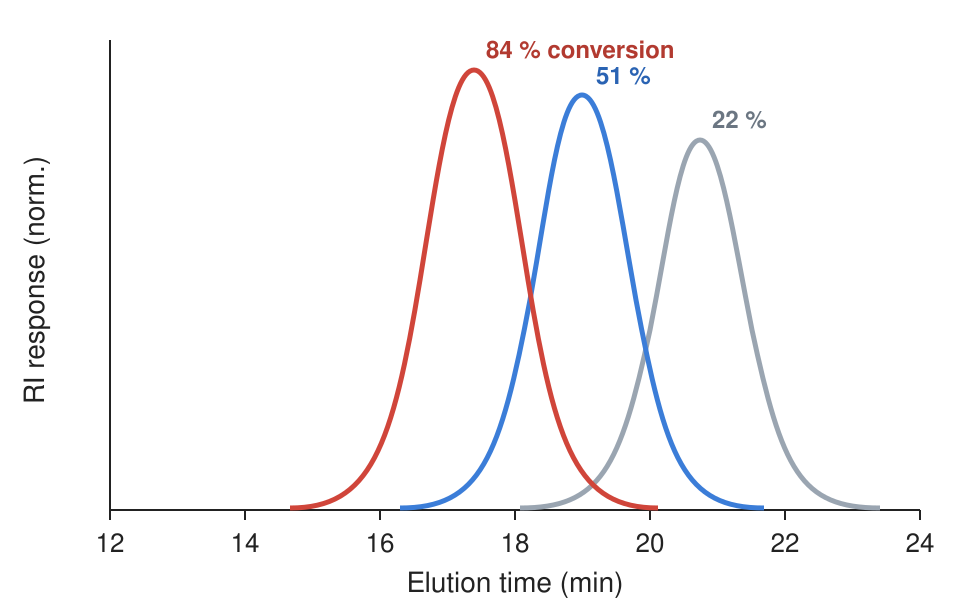

{{nyml
kind: document
carrier: slides
uid: doc-exampleraft0001
title: Controlled Radical Polymerization — an orz-slides example
author: Yu Wang
theme: orchard
ratio: 16:9
footer: CHEM 512 · Controlled radical polymerization
}}

<!-- slide template=title -->
# Controlled Radical Polymerization: How RAFT Keeps Every Chain Growing Together
## Mechanism, kinetics and molecular-weight control
**Yu Wang** · Department of Chemistry, University of Louisiana at Lafayette\
CHEM 512 · Polymer Synthesis seminar · October 2026
<!-- @notes -->
Title page. The long title is deliberate: it must wrap, never be cut (D-46).

<!-- slide template=outline -->
## Today
1. **Mechanism and kinetics**
2. Molecular-weight control
3. RAFT in the lab
4. Outlook and open questions

<!-- slide template=section -->
# Mechanism and kinetics
Why a reversible chain transfer keeps all chains growing at the same rate

<!-- slide step -->
## Why control matters

A free-radical polymerization makes chains that start, grow and die within a second. RAFT adds a **reversible** step, so every chain spends most of its life asleep.

- Chains grow together: dispersity $Đ \to 1$
- $M_n$ rises linearly with conversion
- End groups survive, so blocks can be added later
- The rate is still set by the initiator

<!-- slide 2col 3/2 -->
## The RAFT equilibrium
<!-- @left -->
Active and dormant chains swap the thiocarbonylthio end through an intermediate radical:

$$\ce{P_n^{.} + S=C(Z)SR <=> P_nSC(Z)=S + R^{.}}$$

First order in monomer, at a constant radical count:

$$\ln\frac{[M]_0}{[M]_t} = k_p^{\text{app}}\,t$$

$$M_n^{\text{th}} = \frac{[M]_0\,p}{[\text{CTA}]_0}\,M_{\text{mono}} + M_{\text{CTA}}$$

<!-- @right -->
{{smiles S=C(SC(C)(C)C#N)c1ccccc1}}

*CPDB*, a dithiobenzoate RAFT agent: Z = phenyl, R = 2-cyano-2-propyl.

::: info
**Rule of thumb.** Choose R· to leave faster than P· and to re-initiate quickly.
:::

<!-- slide template=section -->
# Molecular-weight control
Why $M_n$ follows conversion, and how to read a GPC trace

<!-- slide row auto/1 { head; col 3/2 { code; data } } -->
## Predicting $M_n$ from conversion
<!-- @head -->
The theory line is one function; the table checks it against four GPC runs.
<!-- @code -->
```python
def mn_theory(conv, m0, cta0,
              m_mono=100.12, m_cta=221.3):
    """Theoretical Mn (g/mol) for RAFT."""
    dp = conv * m0 / cta0
    return dp * m_mono + m_cta

for p in (0.22, 0.51, 0.84):
    mn = mn_theory(p, 4.7, 0.0235)
    print(f"{p:.0%}: {mn:,.0f}")
```
<!-- @data -->
| Run | Conv. | $M_n$ (kg/mol) | Đ |
|---|---:|---:|---:|
| 1 | 22 % | 4.6 | 1.18 |
| 2 | 51 % | 10.4 | 1.12 |
| 3 | 84 % | 17.1 | 1.09 |
| FRP | 80 % | 41.0 | 1.94 |

<!-- slide 2col -->
## Kinetics at a glance
<!-- @left -->
{{chart
type: line
labels: 0, 1, 2, 3, 4, 5, 6
series: RAFT = 0, 0.21, 0.42, 0.63, 0.85, 1.05, 1.27
series: Free radical = 0, 0.45, 0.72, 0.88, 0.96, 1.0, 1.02
}}

<!-- @right -->
{{mermaid
graph TD
  I[Initiator] --> R[Radical R·]
  R --> P[Active chain P·]
  P <--> D[Dormant RAFT adduct]
  P --> T[Termination]
}}

<!-- slide quad -->
## Before you start a RAFT run
<!-- @tl -->
::: warning
**Oxygen kills radicals.** Three freeze–pump–thaw cycles, or 30 min of N₂ sparging.
:::
<!-- @tr -->
> Control is a property of the equilibrium, not of the initiator.

— lecture note
<!-- @bl -->
- [x] CTA purified
- [x] Monomer passed through alumina
- [ ] Initiator : CTA = 1 : 5
<!-- @br -->
::: success
**Check:** $M_n$ grows **linearly** with conversion and Đ stays below 1.2.
:::
{{sp[success] living}} {{sp[info] dormant}} {{sp[danger] dead}}

<!-- slide main-side 2/1 -->
## GPC traces shift together
<!-- @main -->

<!-- @side -->
- One narrow peak per sample
- The peak moves to earlier elution as chains grow
- No low-mass tail: few chains died
<!-- @float left=13% top=27% w=17% h=16% -->
**Đ = 1.09** at 84 % conversion

<!-- slide -->
## Choosing a RAFT agent (dense slide: fit scales it)

The Z group sets how fast radicals add to the C=S bond; the R group must leave quickly and re-initiate. Match both to the monomer family, or the polymerization is retarded or uncontrolled.

- **Dithiobenzoates** (Z = Ph): very active; good for methacrylates and styrene; retard acrylates and can hydrolyse.
- **Trithiocarbonates** (Z = SR): the safe default for acrylates, acrylamides and styrene; little retardation; stable.
- **Xanthates** (Z = OR): for less-activated monomers such as vinyl acetate and N-vinylpyrrolidone.
- **Dithiocarbamates** (Z = NR₂): tunable; switchable versions control both monomer families.
- R group: tertiary cyanoalkyl for methacrylates; secondary for acrylates and styrene.
- Keep [I]₀ : [CTA]₀ between 1 : 3 and 1 : 10; more initiator means more dead chains.
- Expect an induction period with dithiobenzoates; plan the sampling times after it.

<!-- slide template=closing -->
# Thank you
## Questions and discussion
**Yu Wang** · Department of Chemistry, University of Louisiana at Lafayette\
Slides and data: markdown.orz.how {{qr https://markdown.orz.how}}
